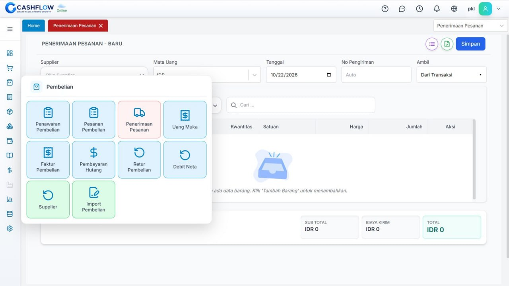
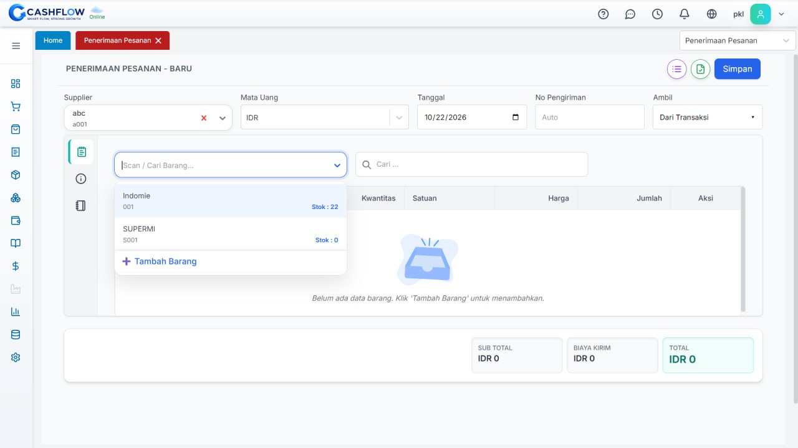
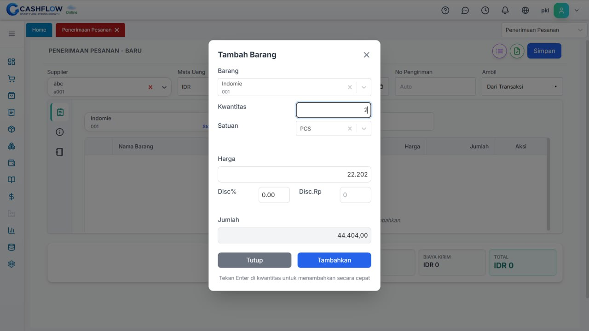
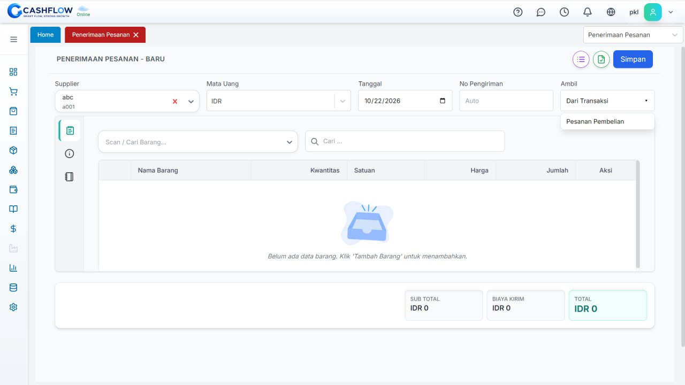
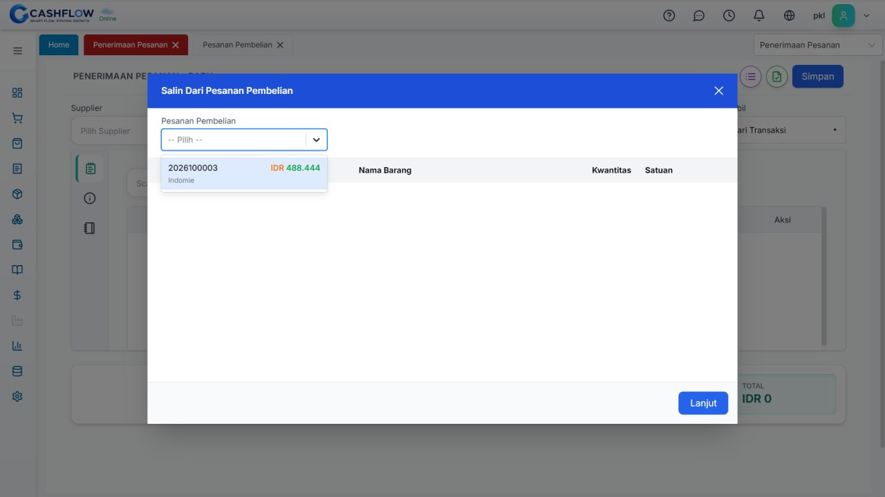

# Panduan CashFlow: Penerimaan Pesanan (Barang Masuk)

Dokumentasi resmi alur operasional penerimaan barang di sistem CashFlow, disesuaikan dari standar dokumentasi Accurate Online.

---

## 1. Membuat Penerimaan Barang (Input Manual / Non-PO)

Gunakan cara ini jika barang datang langsung dari supplier tanpa dibuatkan dokumen Purchase Order (PO) terlebih dahulu.

### Langkah-langkah:

1. **Akses Menu Pembelian:**
   - Masuk ke menu modul **Pembelian** pada sidebar kiri.
   - Klik menu **Penerimaan Pesanan**.
   

2. **Isi Data Header Transaksi:**
   - **Supplier:** Pilih rekanan pemasok barang (contoh: `abc / a001`).
   - **Mata Uang:** Standar `IDR`.
   - **Tanggal:** Masukkan tanggal fisik barang tiba (contoh: `10/22/2026`).
   - **No Pengiriman:** Nomor surat jalan fisik dari pengirim (atau biarkan default `Auto`).

3. **Cari dan Tambah Barang:**
   - Ketik nama barang pada kolom pencarian **Scan / Cari Barang...**.
   - Sistem akan menampilkan daftar stok dan item yang tersedia di master barang (contoh: `Indomie`, stok `22`).
   

4. **Konfigurasi Kuantitas & Harga Beli:**
   - Pada modal dialog **Tambah Barang**, tentukan kuantitas barang fisik yang masuk (contoh: `2 PCS`).
   - Pastikan **Harga Satuan** terisi valid (contoh: `IDR 22.202`).
   - Periksa subtotal barang, lalu klik tombol **Tambahkan**.
   

5. **Simpan Transaksi:**
   - Klik tombol **Simpan** di pojok kanan atas layar untuk membukukan penambahan stok ke kartu gudang.

---

## 2. Membuat Penerimaan Barang Berasal dari Pesanan (Tarik PO)

Gunakan cara ini jika perusahaan sebelumnya sudah menerbitkan dokumen Purchase Order (PO) resmi ke supplier.

### Langkah-langkah:

1. **Buka Form Baru & Pilih Supplier:**
   - Buka menu **Pembelian** ➔ **Penerimaan Pesanan**.
   - Pilih nama **Supplier** yang sama dengan data di Purchase Order.

2. **Tarik Dokumen Pesanan Pembelian:**
   - Pada sisi kanan form di bagian **Ambil**, klik dropdown **Dari Transaksi**.
   - Pilih opsi **Pesanan Pembelian**.
   

3. **Pilih Nomor Dokumen PO:**
   - Kotak dialog modal **Salin Dari Pesanan Pembelian** akan terbuka.
   - Klik dropdown daftar pesanan pembelian yang masih berstatus terbuka (*outstanding*).
   - Pilih nomor transaksi PO terkait (contoh: nomor `2026100003` - item `Indomie` senilai `IDR 488.444`).
   

4. **Sesuaikan Kuantitas (Jika Diterima Parsial):**
   - Klik tombol **Lanjut**.
   - Seluruh baris item, jumlah pesanan, dan harga akan otomatis terisi ke tabel.
   - Jika kiriman fisik supplier belum lengkap (sebagian), ubah nilai **Kuantitas** sesuai dengan jumlah fisik yang diterima saat itu. Sisa barang akan tetap tercatat sebagai pesanan belum selesai.

5. **Simpan Dokumen:**
   - Klik tombol **Simpan** di pojok kanan atas.

---

## 3. Penanganan Error: Pengeluaran Nilai Nol (Rp 0)

Sama seperti Accurate Online, CashFlow menjalankan sistem pembukuan persediaan perpetual.

### Mengapa Terjadi Error Nominal Nol?
- **Penyebab:** Pada form transaksi, kolom nilai barang atau **TOTAL IDR** bernilai `0`.
- **Dampak Akuntansi:** Jurnal persediaan membutuhkan nilai rupiah untuk membukukan:
  - *(Debit)* Persediaan Barang Masuk
  - *(Kredit)* Penerimaan Belum Difakturkan (Hutang Belum Tertagih)
- Jika nilai total transaksi adalah `IDR 0`, sistem menolak transaksi karena tidak ada aset finansial yang dapat dijurnal.

### Solusi / Penanganan:
1. **Untuk Penerimaan Manual:**
   - Pastikan nilai harga beli pada modal **Tambah Barang** tidak dikosongkan atau bernilai `0`.
   - Pastikan **TOTAL IDR** di pojok kanan bawah bernilai lebih dari Rp 0 sebelum menekan **Simpan**.
2. **Untuk Penerimaan dari PO:**
   - Jika saat ditarik dari PO nilai barang muncul Rp 0, buka kembali menu **Pesanan Pembelian (PO)** asal.
   - Edit dokumen PO tersebut dan isi harga beli satuan barang dengan benar.
   - Simpan dokumen PO, kemudian tarik ulang data PO tersebut pada form Penerimaan Pesanan.
